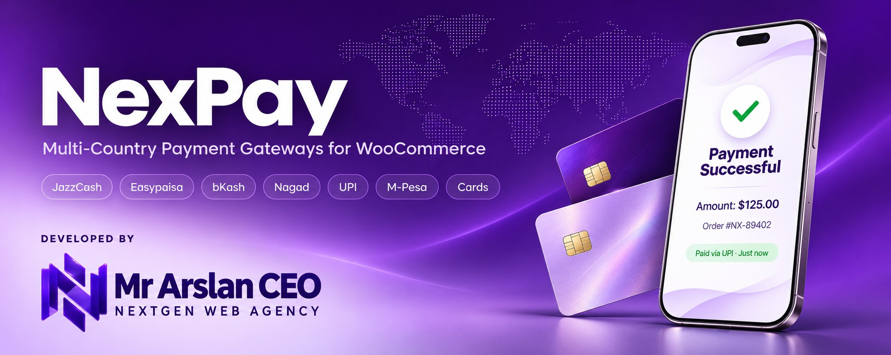
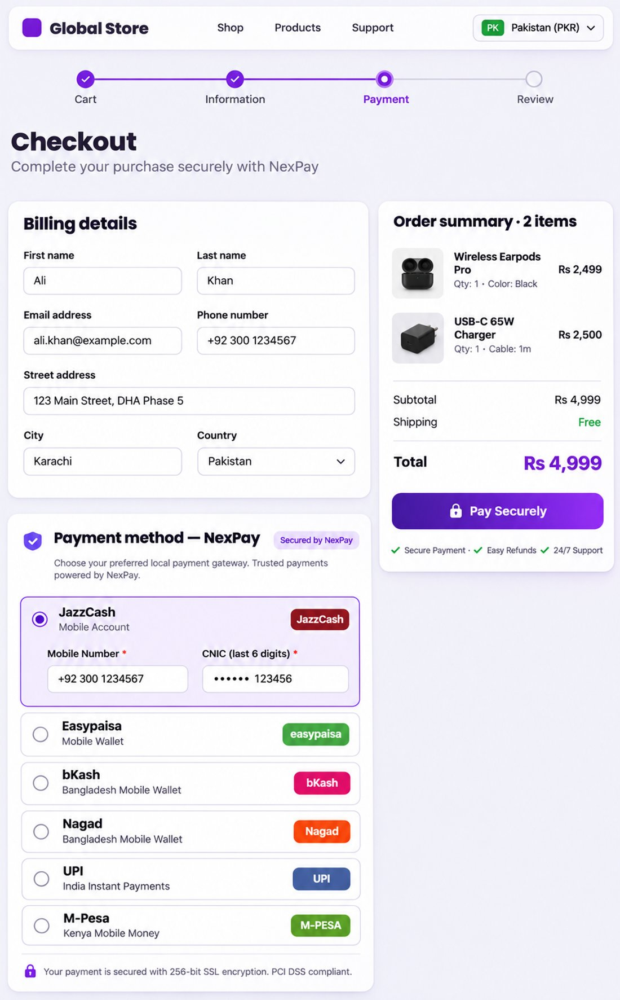
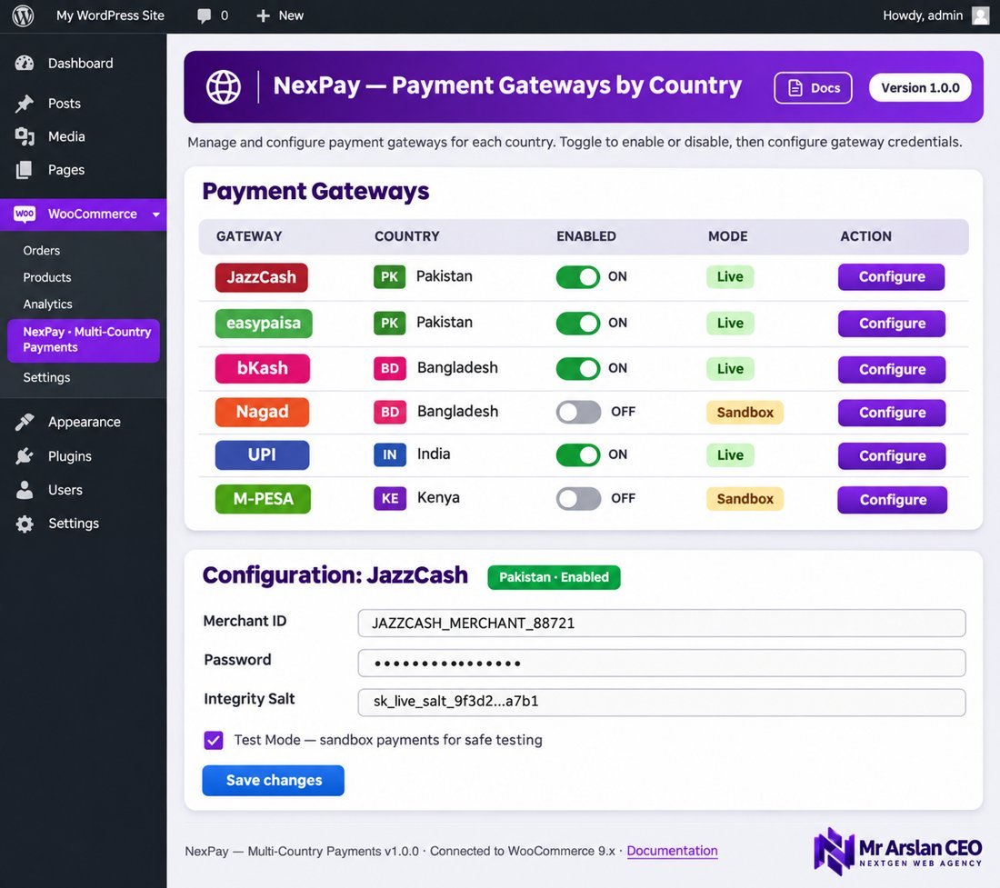

  

<h1 align="center">NexPay — Multi-Country Payment Gateways for WooCommerce</h1>

  
  
  
  
  

  <strong>One free plugin. Six local payment gateways. Four countries.</strong> 
  Accept JazzCash &amp; Easypaisa (Pakistan), bKash &amp; Nagad (Bangladesh), UPI (India) and M-Pesa (Kenya) in WooCommerce — no premium version, no license keys.

---

## ✨ Features

- 🌍 **6 gateways, 4 countries** — one consistent settings experience instead of six separate plugins
- 🧪 **Sandbox / test mode** for every gateway — test safely, then flip to Live
- 🔐 **Provider-verified callbacks** — HMAC-SHA256 signed IPN (JazzCash), keyed-hash postback verification (Easypaisa), server-side execution & verification (bKash, Nagad), Daraja STK Push Query confirmation (M-Pesa). Orders are only paid on verified, amount/currency-matched confirmations — see [docs/SECURITY.md](docs/SECURITY.md)
- 🛒 **HPOS + Blocks** — HPOS compatible, with a real Cart/Checkout Blocks payment-method integration for all six gateways
- 🎨 **Matching NexPay design** — purple gateway rows with brand badges at checkout, and a gateways-by-country overview in the admin
- 🌐 **Fully translatable** — text domain `nexpay`, POT file included
- 🆓 **100% free & open source** — GPL-2.0-or-later

## 💳 Supported Gateways

| Country | Gateway | Currency | How it works |
|---|---|---|---|
| 🇵🇰 Pakistan | **JazzCash** | PKR | Mobile Account (MWALLET) API — HMAC-SHA256 `pp_SecureHash` + verified IPN |
| 🇵🇰 Pakistan | **Easypaisa** | PKR | Hosted payment page — signed payload + hash-verified postback |
| 🇧🇩 Bangladesh | **bKash** | BDT | Tokenized Checkout — token grant → create payment → execute on callback |
| 🇧🇩 Bangladesh | **Nagad** | BDT | RSA-signed initialize/complete checkout + Payment Verification API |
| 🇮🇳 India | **UPI** | INR | UPI intent deep link (`upi://pay?...`), order on-hold until manual verification |
| 🇰🇪 Kenya | **M-Pesa** | KES | Safaricom Daraja — OAuth + STK Push (Lipa na M-Pesa) + callback |

> A gateway only appears at checkout when your store currency matches its settlement currency (PKR / BDT / INR / KES).

## 📸 Screenshots

**Checkout** — customers choose their local gateway; JazzCash is selected with its mobile number and CNIC fields:

**Admin — WooCommerce → NexPay** — every gateway by country, with live enabled state, Live/Sandbox mode and Configure links:

## 📦 Installation

1. Download this repository as a ZIP (or clone it) and upload it via **Plugins → Add New → Upload Plugin** — or copy the `nexpay` folder to `wp-content/plugins/`.
2. Activate **NexPay** in WordPress.
3. Open **WooCommerce → NexPay** to see all gateways by country.
4. Click **Configure** on the gateway you want, enter your merchant credentials, tick **Enable**, and save.
5. Keep **Test mode** enabled while testing with sandbox credentials; disable it to accept real payments.

**Requirements:** WordPress 6.0+, WooCommerce 7.0+, PHP 7.4+.

## ⚙️ Configuration (per gateway)

- **JazzCash** — Merchant ID, Password and Integrity Salt from the JazzCash merchant portal. Checkout asks for the customer's mobile number and CNIC (last 6 digits). Set your JazzCash IPN/return URL to the one shown by WooCommerce for this gateway (the plugin registers `wc-api=nexpay_jazzcash`).
- **Easypaisa** — Store ID, merchant Account Number and **Merchant Hash Key**. Customers are redirected to the Easypaisa hosted page and returned automatically; the postback is verified with the keyed hash (plus store, amount and currency checks) before the order is paid. Without a Hash Key, postbacks are rejected.
- **bKash** — App Key, App Secret, Username and Password from the bKash developer portal. Uses the tokenized checkout; the payment is executed server-side when the customer returns.
- **Nagad** — Merchant ID, Merchant Number, the Nagad PGW Public Key and your Merchant Private Key (used for RSA encryption/signing). Payments are confirmed with the Nagad Verification API.
- **UPI** — Your merchant UPI ID (VPA, e.g. `yourstore@okbank`) and Payee Name. The customer pays with any UPI app via the intent link on the thank-you page; the order stays **On hold** until you verify the payment manually and complete it (workflow in [docs/SETUP.md](docs/SETUP.md)).
- **M-Pesa** — Consumer Key, Consumer Secret, Business Shortcode and Passkey from the Safaricom Daraja portal. Customers get an STK Push prompt on their phone and approve with their PIN; results are confirmed with the Daraja STK Push Query API before the order is paid.

Full per-gateway instructions (credentials, callback URLs, modes): **[docs/SETUP.md](docs/SETUP.md)**.

## ✅ Verification status

| Gateway | Implemented | Unit-tested | Sandbox E2E |
|---|---|---|---|
| JazzCash | ✅ | ✅ hash vectors, IPN rules | ⏳ Pending merchant credentials |
| Easypaisa | ✅ | ✅ keyed hash + postback accept/reject matrix | ⏳ Pending merchant credentials |
| bKash | ✅ | ✅ execute-response verification | ⏳ Pending merchant credentials |
| Nagad | ✅ | ✅ verification matching, HTTPS endpoints | ⏳ Pending merchant credentials |
| UPI | ✅ | ✅ intent URI builder | n/a (no provider API; manual settlement) |
| M-Pesa | ✅ | ✅ phone normalization | ⏳ Pending merchant credentials |

Details and evidence: [docs/COMPATIBILITY.md](docs/COMPATIBILITY.md).

## ⚠️ Known limitations

- **UPI payments are verified manually.** There is no UPI callback; orders stay On hold until the merchant checks the payment (amount + transaction reference) in their bank/UPI statement. Never complete a UPI order from a customer screenshot alone.
- **Sandbox end-to-end testing requires merchant credentials** and a publicly reachable HTTPS callback URL for each provider. Until you have run a sandbox payment for a gateway yourself, treat that gateway as implemented + unit-tested, not production-proven.
- **Easypaisa requires the Merchant Hash Key** (new in 1.1.0). If it is empty, Easypaisa postbacks fail closed by design.

## 📚 Documentation

- [Setup guide](docs/SETUP.md) — per-gateway credentials, callback URLs, UPI manual verification
- [Security notes](docs/SECURITY.md) — callback trust model, idempotency, secret handling
- [Compatibility & test evidence](docs/COMPATIBILITY.md)
- [Changelog](CHANGELOG.md)

## ❓ FAQ

**Is NexPay free?**
Yes — free and open source under the GPL. There is no paid tier.

**How does test mode work?**
Every gateway has a *Test mode* checkbox. In test mode the plugin talks to the provider's sandbox endpoints, so no real money moves. JazzCash, Easypaisa, bKash, Nagad and Daraja all provide free sandbox credentials.

**Which currency does my store need?**
PKR for JazzCash/Easypaisa, BDT for bKash/Nagad, INR for UPI and KES for M-Pesa. Gateways hide automatically if the store currency doesn't match.

**Does it work with HPOS and the block checkout?**
Yes. NexPay is HPOS compatible, and since 1.1.0 it ships a real Cart/Checkout Blocks integration: all six gateways register as Blocks payment methods (with their checkout fields), and block orders flow into the same `process_payment()` logic as classic checkout.

**Where do callbacks point?**
Each API gateway registers a WooCommerce API endpoint — `wc-api=nexpay_jazzcash`, `wc-api=nexpay_easypaisa`, `wc-api=nexpay_bkash`, `wc-api=nexpay_nagad`, `wc-api=nexpay_mpesa` — and sends it to the provider automatically (as the return/IPN/callback URL) during payment creation.

## 🤝 Contributing

Contributions are welcome — new gateways, new countries, bug fixes and translations.

1. Fork the repository and create a feature branch.
2. Follow the WordPress Coding Standards; every PHP file must pass `php -l`.
3. Never commit real merchant credentials or keys (sandbox test data only).
4. Open a pull request describing what you changed and how you tested it.

Please report bugs and request gateways via [GitHub Issues](https://github.com/mrdigitalceo/nexpay/issues).

## 📄 License

NexPay is free software, released under the **GNU General Public License v2.0 or later** — see the [LICENSE](LICENSE) file for the full text. You may use, copy, modify and redistribute it under the terms of that license.

## 👤 Author

**Mr Arslan CEO** — [NextGen Web Agency](https://mrarslanceo.site)

- 🌐 Website: [mrarslanceo.site](https://mrarslanceo.site)
- 💻 GitHub: [github.com/mrdigitalceo](https://github.com/mrdigitalceo)
- 📸 Instagram: [instagram.com/mrarslanceo](https://instagram.com/mrarslanceo)
- ▶️ YouTube: [youtube.com/@mrarslanceo](https://youtube.com/@mrarslanceo)
- 👍 Facebook: [facebook.com/mrdigitalceo](https://facebook.com/mrdigitalceo)
- 🛠️ Fiverr: [fiverr.com/mrdigitalceo](https://www.fiverr.com/mrdigitalceo)
- 💬 WhatsApp: [wa.me/923164309537](https://wa.me/923164309537)
- 🧩 Codester: [codester.com/mrdigitalceo](https://www.codester.com/mrdigitalceo)

---

Made with ❤️ by <strong>Mr Arslan CEO</strong> · NextGen Web Agency

